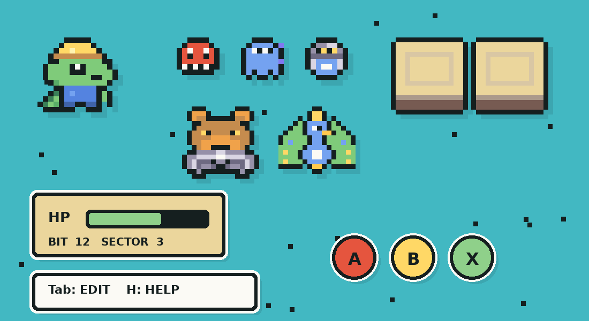
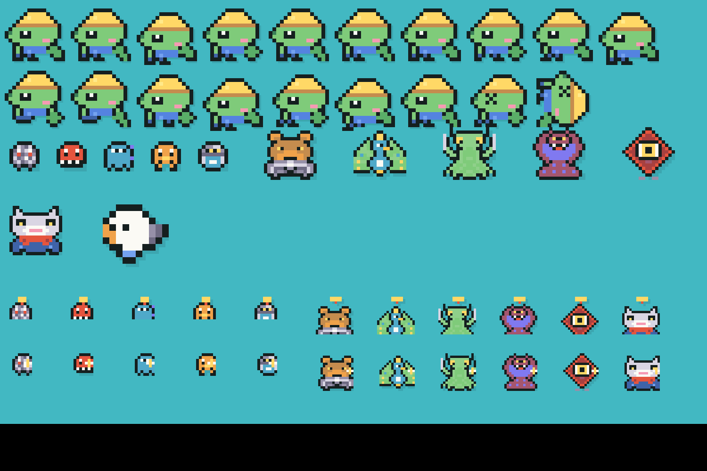
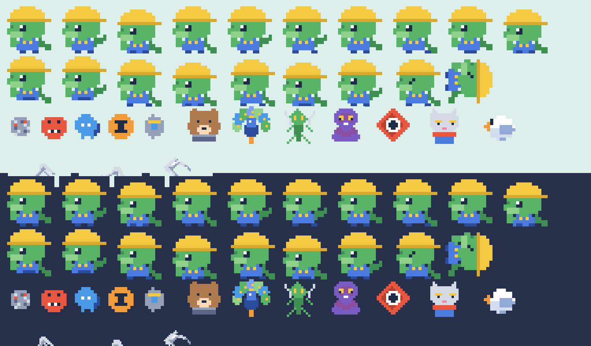

# 画風ガイドと、画風の切り替え

> **方針の更新**: 見比べた結果、目指す画風を **FLAT（ミニマルフラット）** に決めました。SOFT は比較用に残してあります。

## 切り替え方（元に戻す方法）
URLの末尾に `?theme=` を付けると、画風を選べます。

| URL | 画風 |
|---|---|
| `…/geko-enar-playtest/?theme=classic` | これまでの画風（CLASSIC） |
| `…/geko-enar-playtest/?theme=flat` | **目指す画風（FLAT・制作中。キャラクターまで）** |
| `…/geko-enar-playtest/?theme=soft` | 比較用の画風（SOFT。太い輪郭のやわらかい絵） |
| 指定なし | 既定の画風（現在は CLASSIC。SOFTが完成したら SOFT に切り替えます） |

CLASSIC の素材（`geko_art.pyxres`）は書き換えず、そのまま残します。SOFT は別ファイル（`geko_art_soft.pyxres`）で作るので、いつでも戻せます。

## SOFT の方針
参考にしたのは、太い黒の輪郭と、ふんわりした淡い色、ずらした影、丸みのあるデフォルメです。

- **輪郭**: 純粋に近い黒（`#151F1F`）。太く見せるため、主人公と小物は「2×2ピクセルを1ドット」とみなした粗い絵（16×16相当）で描く
- **塗り**: 淡い色を2〜3階調。陰影は1段だけ
- **影**: 背景より少し濃い同系色を、右下へ1ドットずらして置く
- **UI**: 白い縁取り（外側） → 太い黒線 → 淡い塗り、の3重。角は丸める
- **背景**: ステージごとに明るいフラット色。細かい黒い点を少し散らす
- **文字**: 輪郭と同じ黒。強調は塗りの色を使う

## パレット（45色のうち主な色）
| 用途 | 色 |
|---|---|
| 輪郭 | `#151F1F` |
| 白 / 淡い灰 / 灰 | `#FBFAF5` / `#D9D5E3` / `#9690A8` |
| 赤 / 橙 / 黄 | `#E5553E` / `#F0A24A` / `#FFD866` |
| 緑 / 青 / 桃 | `#8FD08A` / `#4FA9C9` / `#F59AB3` |
| クリーム / 砂 / 茶 | `#EBD69C` / `#D9C7A4` / `#775B52` |
| 背景の影 | `#3CA6B0` |

## ステージの背景色（案）
| ステージ | 背景 |
|---|---|
| スタートアップ | ティール `#42B8C2` |
| PEACOCK | ミント `#7CCFA6` |
| MANTIS | ライムグリーン `#B5D86B` |
| GRIZZLY | ピーチ `#F0B88A` |
| VIPER | ラベンダー `#B7A6E8` |
| EXECUTIVE AI | ローズ `#F0A0B8` |
| 探索マップ | スカイ `#8CC8F0` |

## 進め方
1. 切り替えの仕組みと、このガイド（完了）
2. 主人公・レンチ・敵・ライバル・相棒（完了）
3. ブロックと背景
4. ゲーム内のHUD・UI と、スマホ画面のボタン類

SOFT では、段階2までの絵が新しくなっています。ブロック・背景・HUD・NPCの顔などは、まだ CLASSIC の絵を新しいパレットで表示している仮の状態です（段階3・4で描き直します）。

### 段階2で描き直したもの
- 主人公ゲコ: 歩く・待つ・ジャンプ・攻撃・被ダメージ・倒れる（全19コマ）。16×16の粗い絵を2倍に拡大
- レンチ（素材と攻撃6コマ×2種）、攻撃の風切り
- 敵10種（小型5・ボス5）と、それぞれの予備動作・攻撃ポーズ、ライバル（OGAMI）
- 相棒エナー（白い鳥）。SOFTでは頭が大きいぶん、少し後ろ・上に浮かせる
- 手の位置（レンチを握る位置）も、SOFT用の表に切り替え（`animation.py`）

---

## FLAT（ミニマルフラット）
- **輪郭なし**: 色の面だけで形をつくる。目や細部は、暗い色（`#1F2A44`）の小さな点で足す
- **塗り**: 1〜2色。陰影は濃い同系色の帯を1本まで
- **形**: 円・四角・三角でまとめた単純な形。主人公は16×16の粗い絵を2倍に拡大
- **背景**: 明るい版と暗い版の両方で読めること。ステージごとに色を変える
- **進み具合**: 主人公・相棒・レンチ・敵・ライバルを描き直し済み。ブロック・背景・HUD・UIは、まだ CLASSIC の絵を FLAT のパレットで表示しているだけ（今後描き直す）
- **注意点**: 編集モードの白黒表示は明るさの差で見分けるので、近い明るさの色が隣り合うと同化する。色を決めるとき、明るさに差をつける

